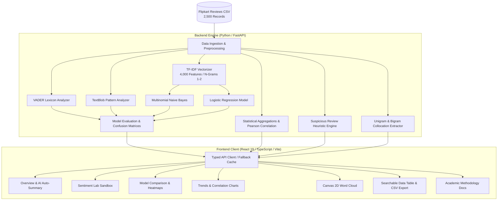

# 🛍️ Flipkart Sentix — Interactive Sentiment Intelligence Dashboard
### Data Analytics & Visualization (DAV) College Capstone Project

[](https://react.dev/)
[](https://www.typescriptlang.org/)
[](https://vitejs.dev/)
[](https://tailwindcss.com/)
[](https://fastapi.tiangolo.com/)
[](https://python.org)
[](https://scikit-learn.org/)
[](LICENSE)

---

## 📌 Executive Summary

**Flipkart Sentix** is an end-to-end Data Analytics & Visualization (DAV) system designed to analyze, benchmark, and visualize customer sentiment across thousands of e-commerce reviews on Flipkart.

By integrating **rule-based lexicon heuristics** (NLTK VADER, TextBlob) alongside **supervised machine learning classifiers** (TF-IDF + Multinomial Naive Bayes and Logistic Regression), this platform enables students, data scientists, and business analysts to investigate algorithmic divergence, temporal sentiment trajectories, festive sales seasonality, and automated fake/suspicious review detection.

---

## 🏗️ System Architecture



---

## 🎯 Key Pages & Functional Modules

### 1. 📊 Executive Overview
* **KPI Metric Cards**: Total reviews analyzed, average consumer star rating, positive sentiment share %, and active model accuracy.
* **Natural-Language Auto-Summary**: Dynamic insight banner automatically summarizing highest-performing categories, dominant customer grievances, and statistical correlation.
* **Sentiment Donut Chart**: Proportional breakdown of Positive, Neutral, and Negative sentiments with interactive tooltips and center metrics.
* **Category Breakdown Bar Chart**: Stacked sentiment comparison across Mobiles, Electronics, Audio, Fashion, Home & Kitchen, and Appliances.
* **PDF Snapshot Export**: One-click action allowing users and professors to generate a printable report of the dashboard.

### 2. 🧪 Sentiment Lab (Interactive Multi-Model Sandbox)
* **Real-Time Text Tester**: Type or paste any product review or pick from presets (*Sarcastic*, *Paisa Vasool Flagship*, *Subtle Mixed Review*) to watch all 4 algorithms evaluate the review simultaneously.
* **Side-by-Side Model Scores**: Inspect VADER compound polarity, TextBlob subjectivity, and probabilistic classification confidence for Naive Bayes and Logistic Regression.
* **Consensus Detection**: Highlights whether models reached a *Unanimous Agreement*, *Majority Agreement*, or *Split Decision*.
* **Agreement & Divergence Chart**: Quantifies consensus percentages across all 2,500 reviews.

### 3. ⚖️ Model Comparison & Heatmaps
* **Evaluation Metrics Bar Chart**: Macro-averaged Precision, Recall, Accuracy, and F1-score comparison for Multinomial Naive Bayes vs Logistic Regression.
* **Interactive 3x3 Confusion Matrix Heatmaps**: Normalized color-intensity matrix highlighting true positives vs misclassifications across Positive, Neutral, and Negative ratings.
* **Statistical Verdict**: Auto-generated takeaway explaining which model excels and where neutral classification errors occur.

### 4. 📈 Longitudinal Trends & Seasonality
* **Monthly Volume Trajectory**: Net positive and negative review trends mapped across time.
* **Festive Seasonality Insights**: Documenting demand and satisfaction surges during Indian shopping holidays (e.g. *Big Billion Days*, Diwali sales).
* **Correlation Scatter Plots**:
  * **Rating vs Sentiment Score**: Validates strong alignment ($r = 0.751$).
  * **Review Length vs Helpful Votes**: Examines whether longer reviews receive more community helpfulness votes ($r = 0.008$).

### 5. ☁️ N-Gram Lexicon & Word Cloud
* **Custom HTML5 Canvas 2D Word Cloud**: High-DPI canvas implementation with an Archimedean spiral collision detection algorithm for positive and negative lexicons with interactive hover frequencies.
* **Bigram Collocation Table**: Highlights top 2-word customer phrases (e.g. `"battery life"`, `"build quality"`, `"paisa vasool"`, `"customer support"`, `"heating issue"`).

### 6. 🔍 Consumer Reviews Explorer
* **Search & Filter Engine**: Real-time debounced full-text search across review text, product titles, and reviewer names.
* **Multi-Parameter Filtering**: Filter by category, sentiment label, or sort by rating, date, helpfulness, and review length.
* **Suspicious Review Filter**: Instant toggle to inspect flagged anomaly reviews.
* **Download Filtered CSV**: Exports any active search filter directly to a CSV file.

### 7. 📖 About & Methodology
* **Academic Documentation**: Formal explanation of dataset attributes, VADER compound scoring logic, TextBlob polarity formulas, and TF-IDF supervised learning setup.

---

## 🔬 Sentiment Scoring Methodologies

| Approach | Technology | Classification Thresholds | Best Suited For |
| :--- | :--- | :--- | :--- |
| **Method A: Lexicon Heuristic** | NLTK VADER | Compound $\ge 0.05 \implies$ Positive<br/>$-0.05 < \text{Score} < 0.05 \implies$ Neutral<br/>$\le -0.05 \implies$ Negative | Informal slang, punctuation emphasis, emojis |
| **Method B: Pattern Lexicon** | TextBlob | Polarity $> 0.10 \implies$ Positive<br/>$-0.10 \le \text{Score} \le 0.10 \implies$ Neutral<br/>$< -0.10 \implies$ Negative | Adjective-noun modifiers, subjectivity analysis |
| **Method C: Supervised ML** | TF-IDF + Multinomial NB | Trained on 80/20 Stratified Split<br/>(Ground truth: Ratings 4-5=Pos, 3=Neu, 1-2=Neg) | High-dimensional unigram/bigram token frequencies |
| **Method D: Supervised ML** | TF-IDF + Logistic Regression ($C=1.0$) | Evaluated with Macro Precision, Recall, F1, and 3x3 Confusion Matrix | Subtle contextual patterns and nuanced negation |

---

## 🚨 Suspicious Review Anomaly Heuristics

To simulate commercial e-commerce trust-and-safety filters, three automated heuristic rules flag suspicious reviews:
1. **Short Review Anomaly**: 5-star rating with $\le 12$ characters (e.g., `"Good"`, `"Nice ok"`, `"Super"`), typical of review farm bots.
2. **Extreme Polarity Mismatch**: Star rating of 5 but text sentiment is strongly negative ($<-0.35$), or rating of 1 with enthusiastic praise ($>0.45$).
3. **Duplicate Spam Detection**: Identical review body text submitted across different reviewer accounts.

---

## 📁 Repository Structure

```
dav cbp/
├── backend/
│   ├── data/
│   │   └── flipkart_reviews.csv       # 2,500 reviews across 6 product categories
│   ├── generate_dataset.py            # Reproducible dataset generator
│   ├── analysis.py                    # VADER, TextBlob, ML training, & metrics
│   ├── models.py                      # Pydantic request/response validation
│   ├── requirements.txt               # Backend dependencies
│   └── main.py                        # FastAPI endpoints with CORS enabled
│
├── frontend/
│   ├── src/
│   │   ├── components/                # KpiCard, FilterBar, DataTable, ThemeToggle, Charts
│   │   │   └── charts/                # Canvas WordCloud, ConfusionHeatmap, Donut, etc.
│   │   ├── pages/                     # 7 Full-featured interactive pages
│   │   ├── lib/
│   │   │   ├── api.ts                 # Typed API caller + automatic cloud fallback
│   │   │   └── fallbackData.ts        # Precomputed benchmark dataset for Vercel
│   │   ├── App.tsx                    # Root dashboard layout
│   │   └── index.css                  # Typography, glassmorphism, & dark mode
│   ├── tailwind.config.js
│   └── package.json
│
├── README.md                          # Comprehensive project documentation
└── .gitignore                         # Clean git rules excluding venv and node_modules
```

---

## 💻 Local Setup & Installation

### Prerequisites
* **Python 3.10+**
* **Node.js 18+** & **npm**

### 1. Backend Setup (FastAPI)
```bash
# Navigate to backend directory
cd backend

# Create and activate virtual environment
python3 -m venv venv
source venv/bin/activate    # On Windows use: venv\Scripts\activate

# Install dependencies
pip install -r requirements.txt

# Download required NLTK corpora
python3 -c "import ssl, nltk; ssl._create_default_https_context = ssl._create_unverified_context; nltk.download('vader_lexicon'); nltk.download('stopwords')"

# Start the API server
uvicorn main:app --reload --port 8000
```
* **API Endpoint**: `http://127.0.0.1:8000`
* **Interactive Swagger UI**: `http://127.0.0.1:8000/docs`

---

### 2. Frontend Setup (React + Vite)
```bash
# Open a new terminal tab and navigate to frontend
cd frontend

# Install dependencies
npm install

# Start Vite development server
npm run dev
```
* **Web App URL**: `http://localhost:5173`

---

## 🌐 Cloud Deployment (Vercel)

This application is built with a **dual-mode data layer**:
1. **Local Mode**: Directly connects to your local FastAPI server at `http://127.0.0.1:8000`.
2. **Cloud Mode (Vercel)**: Automatically engages a precomputed benchmark fallback dataset (`fallbackData.ts`) so anyone visiting your live Vercel URL can interact with all 7 pages, charts, filters, and word clouds immediately—even without running the Python server locally!

### Deploying Frontend to Vercel:
1. Import the repository into **[Vercel](https://vercel.com/)**.
2. Set **Root Directory** to: `frontend`
3. Click **Deploy**.

---

## 👥 Contributors

* **Y Sridhar** ([@sridhar26-08](https://github.com/sridhar26-08))
* Project developed for the **Data Analytics & Visualization (DAV)** Course.
